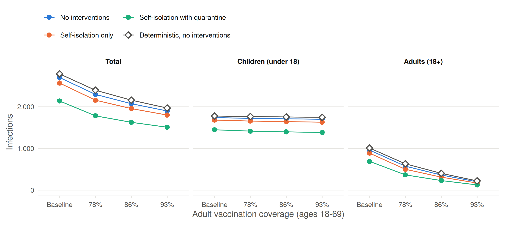

# Sensitivity analysis: adult vaccination (R0 = 9)

The three focal scenarios of Figure 4 at R0 = 9
(`make population_immunity`), for each assumption on the vaccination
coverage of adults aged 18 to 69: the current one (`baseline`) and the
alternate adult immunization assumptions of the [`multigroup.vaccine`
vignette](https://epiforesite.github.io/multigroup-vaccine/articles/experiments/utaz_age_school.html),
with 78%, 86%, and 93% coverage. Each scenario has 1,000 runs; runs with
fewer than 10 cases are excluded as early extinctions. As in Figure 4,
self-isolation with quarantine uses the run with quarantine and the
other two scenarios the run without. For reference, the table and figure
include the deterministic final sizes of the vignette’s compartmental
model (no interventions). Children are those under 18.

Table 1: Final outbreak size at day 365, median (interquartile range)
across the retained runs; the ratio is of the medians.

| Adult vaccination | Scenario | Retained runs | Total infections | Children | Adults | Child:adult ratio |
|:---|:---|---:|---:|---:|---:|---:|
| Baseline | No interventions | 777 | 2,700 (2,686-2,715) | 1,739 (1,731-1,747) | 961 (951-972) | 1.8 |
| Baseline | Self-isolation only | 703 | 2,567 (2,547-2,585) | 1,680 (1,670-1,691) | 887 (872-899) | 1.9 |
| Baseline | Self-isolation with quarantine | 594 | 2,138 (2,106-2,167) | 1,447 (1,426-1,466) | 690 (673-707) | 2.1 |
| Baseline | Deterministic, no interventions |  | 2,787 | 1,777 | 1,010 | 1.8 |
| 78% | No interventions | 726 | 2,295 (2,280-2,311) | 1,720 (1,713-1,730) | 575 (564-586) | 3.0 |
| 78% | Self-isolation only | 646 | 2,157 (2,138-2,177) | 1,656 (1,644-1,668) | 500 (487-513) | 3.3 |
| 78% | Self-isolation with quarantine | 532 | 1,781 (1,750-1,806) | 1,415 (1,395-1,434) | 366 (353-379) | 3.9 |
| 78% | Deterministic, no interventions |  | 2,395 | 1,764 | 631 | 2.8 |
| 86% | No interventions | 691 | 2,072 (2,059-2,087) | 1,710 (1,700-1,720) | 363 (352-373) | 4.7 |
| 86% | Self-isolation only | 617 | 1,955 (1,937-1,972) | 1,642 (1,630-1,654) | 312 (302-323) | 5.3 |
| 86% | Self-isolation with quarantine | 499 | 1,626 (1,597-1,652) | 1,397 (1,374-1,414) | 230 (219-242) | 6.1 |
| 86% | Deterministic, no interventions |  | 2,157 | 1,754 | 403 | 4.4 |
| 93% | No interventions | 669 | 1,898 (1,885-1,913) | 1,699 (1,689-1,709) | 200 (192-208) | 8.5 |
| 93% | Self-isolation only | 603 | 1,800 (1,783-1,816) | 1,629 (1,616-1,642) | 171 (163-178) | 9.5 |
| 93% | Self-isolation with quarantine | 481 | 1,508 (1,483-1,534) | 1,383 (1,363-1,401) | 126 (119-135) | 11.0 |
| 93% | Deterministic, no interventions |  | 1,968 | 1,746 | 222 | 7.9 |

Figure 1: Final outbreak size at day 365 by adult vaccination
assumption: medians across the retained runs (interquartile ranges in
the table) and deterministic final sizes.

