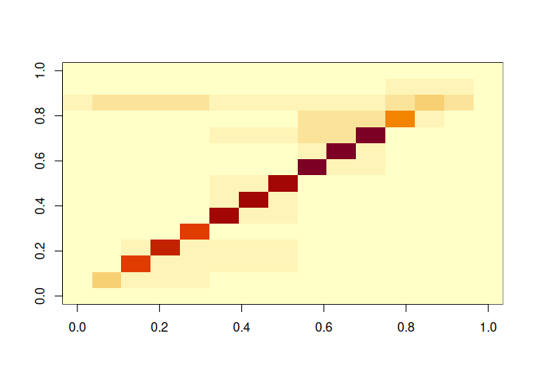
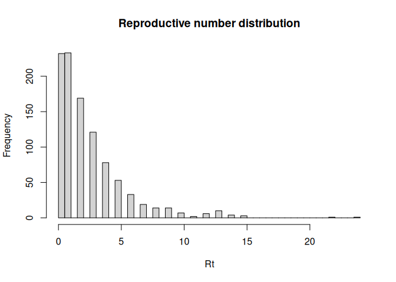
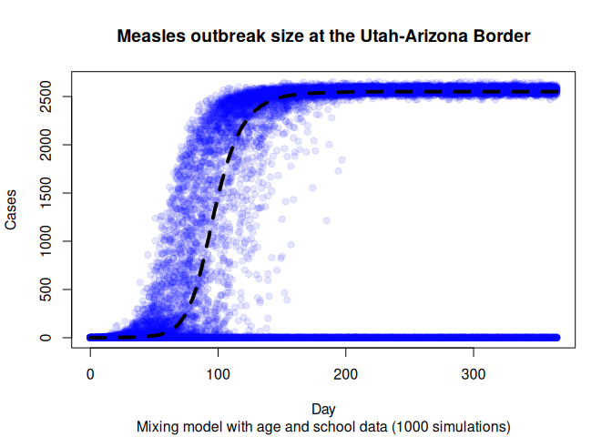
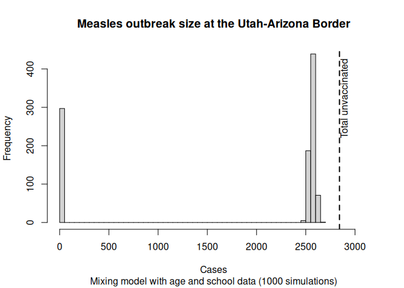
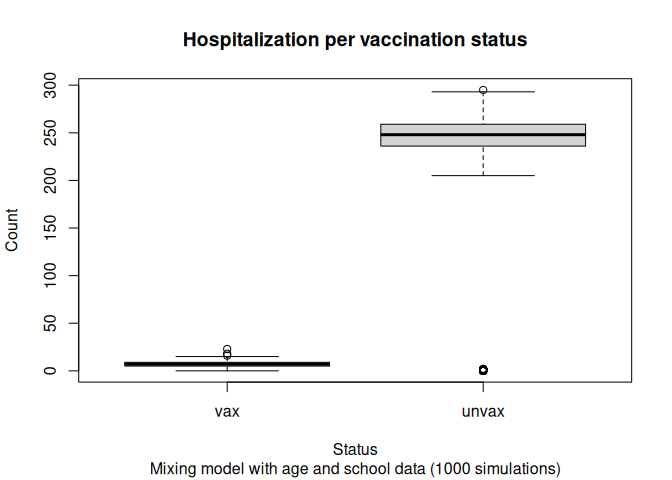
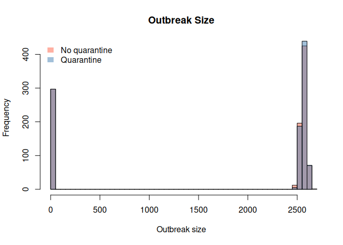
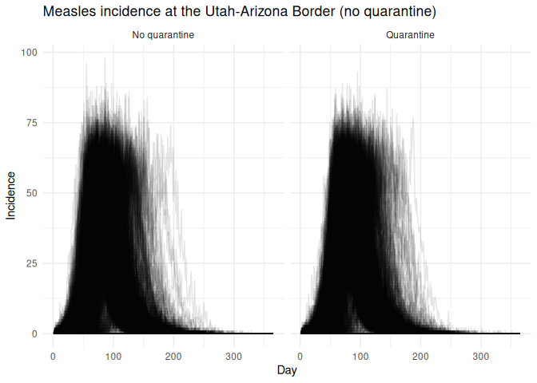

George G. Vega Yon, Ph.D.
2026-11-06

# Scenario of Utah-Arizona Border Measles Outbreak (R0 = 9)

Parameters used for this scenario:

- R0: 9
- Rash contact reduction: 50%
- Isolation willingness: 0%
- Quarantine willingness: 90%
- Contact tracing success rate: 0%
- Adult vaccination assumption: baseline

> [!WARNING]
>
> ### Warning
>
> The data and model used in this vignette are for demonstration
> purposes only and do not reflect real-world conditions accurately. As
> in most agent-based models, the simulations performed here are
> simplified representations of the reality and provide rich information
> for scenario modeling, but not necessarily for forecasting or
> parameter estimation.

During the 2025 US measles outbreak, the number of cases in Utah climbed
rapidly in communities along the Utah-Arizona border. This vignette
shows how we can use the mixing model of the `measles` R package to do
scenario modeling of the situation using both age and school data.

## Set up

We start by loading the `measles` R package. Since the package depends
on <a href="https://cran.r-project.org/package=epiworldR"
target="_blank"><code>epiworldR</code></a>, `epiworldR` is loaded
automatically too:

``` r
library(measles)
```

    Loading required package: epiworldR

    Thank you for using epiworldR! Please consider citing it in your work.
    You can find the citation information by running
      citation("epiworldR")

    Using measles in your research? Please cite it: citation("measles")

For the data, we need two datasets: information about the population
distribution by age and vaccination status, and the contact matrix. Both
are created by [`data/utaz_data.R`](data/utaz_data.R) (`make data`) from
the data released with the [`multigroup.vaccine` R
package](https://github.com/EpiForeSITE/multigroup-vaccine). This data
uses real vaccination rates from publicly available school records, and
population age structure and composition from the latest US census.
Vaccination rates for the non-school-aged population were imputed based
on assumptions and do not reflect the actual vaccination information for
those age groups. The adult vaccination assumption is selected with the
`vax_adults` parameter: `baseline` or the coverage of adults aged 18 to
69 (for example, `78pct`); each assumption is a file
`data/utaz_vaccination_adults_<assumption>.rds`. We can load the needed
data using the `readRDS()` function:

``` r
# The results require measles >= 0.4.1 and epiworldR >= 0.19.0 (with
# clone_epi())
stopifnot(
  packageVersion("measles") >= "0.4.1",
  packageVersion("epiworldR") >= "0.19.0",
  exists("clone_epi", envir = asNamespace("epiworldR")),
  # Builds from UofUEpiBio/measles#69 on draw lognormal stage durations
  "measles build newer than the pinned one (see the README)" =
    !"incubation_period_sd" %in% names(formals(ModelMeaslesMixing))
)
vax_file <- sprintf(
  "data/utaz_vaccination_adults_%s.rds",
  params$vax_adults
)
if (!file.exists(vax_file)) {
  stop(
    "No vaccination data for the assumption '", params$vax_adults,
    "'. Add it with save_vaccination() in data/utaz_data.R."
  )
}
utaz <- readRDS(vax_file)
utaz_matrix <- readRDS("data/utaz_contacts_polymod.rds")
```

If we are using the Epistorm data, we need to adjust it

``` r
if (params$epistorm) {
  utaz_matrix <- readRDS("data/utaz_contacts_epistorm.rds")
}
```

Let’s take a look at the datasets:

``` r
utaz
```

       age_labels agepops agelims  vacc_rate
    1      under1     141       1 0.00000000
    2        1to4     562       4 0.28479657
    3     5to11s1     296      11 0.06418919
    4     5to11s2     413      11 0.36803874
    5     5to11s3     225      11 0.42222222
    6    12to13s4      94      13 0.23404255
    7    12to13s5     163      13 0.36809816
    8    12to13s6      92      13 0.59782609
    9    14to17s7     166      17 0.23493976
    10   14to17s8     158      17 0.37341772
    11   14to17s9     299      17 0.45484950
    12     18to24     817      24 0.37560193
    13     25to44    1391      44 0.66280096
    14     45to69    1016      69 0.95000000
    15        70+      80      90 1.00000000

As we can see, the vaccination rates in this area are significantly low.
The immunity needed to avert an outbreak is close to 93% of the
population. The column `vacc_rate` is the share of each group that is
vaccinated (the model applies the vaccine efficacy, see below). The
overall vaccination rate is 51.9377404%, meaning that 2841.9214122
people are unvaccinated. Let’s now look at the first few entries of the
contact matrix

``` r
# Looking at the first 5 columns
utaz_matrix[, 1:5] |>
  round(2)
```

             under1 1to4 5to11s1 5to11s2 5to11s3
    under1     0.79 1.33    0.32    0.45    0.24
    1to4       0.33 5.55    0.86    1.20    0.66
    5to11s1    0.15 1.64   12.59    2.10    1.14
    5to11s2    0.15 1.64    1.51   13.19    1.14
    5to11s3    0.15 1.64    1.51    2.10   12.23
    12to13s4   0.08 0.60    1.61    2.25    1.22
    12to13s5   0.08 0.60    1.61    2.25    1.22
    12to13s6   0.08 0.60    1.61    2.25    1.22
    14to17s7   0.10 0.45    0.46    0.64    0.35
    14to17s8   0.10 0.45    0.46    0.64    0.35
    14to17s9   0.10 0.45    0.46    0.64    0.35
    18to24     0.09 0.53    0.26    0.37    0.20
    25to44     0.20 1.22    0.67    0.93    0.51
    45to69     0.09 0.59    0.31    0.44    0.24
    70+        0.03 0.26    0.15    0.20    0.11

``` r
# Looking at it as a heatmap
image(utaz_matrix)
```



One important thing to note is that the data in `utaz` must coincide
with that in the contact matrix, particularly, there should be one entry
in the `data.frame` for each row/column of the contact matrix.

## Creating the model

The measles models have many parameters. One that is of particular
importance is the hospitalization rate. The hospitalization rate is not
a probability, so, to match a 10% hospitalization probability, we need
to do some calculations. The hospitalization probability is given by the
following formula:

$$P(\text{hospitalization}) = \frac{\text{hospitalization}_\text{rate}}{\text{hospitalization}_\text{rate} + \text{recovery}_\text{rate}}$$

Where the $\text{recovery}_\text{rate}$ is given by the rash period
(1/duration of it, four days in this simulation). Programatically, we
can do the following:

``` r
N <- sum(utaz$agepops)

# Finding hospitalization rate for
# a 10% hospitalization probability
# P(hosp) = hosp_r / (hosp_r + rec_r)
#   => hosp_r = P(hosp) (hosp_r + rec_r)
#             = P(hosp) * hosp_r + P(hosp) * rec_r
#   => hosp_r = P(hosp) * rec_r / (1 - P(hosp))
rash_period <- 4
h_rate <- 0.1 * (1 / rash_period) / (1 - 0.1)
```

For calibration, we can make use of the function
`calibrate_mixing_model()`, which will give us the needed scaleing
factor to apply to the transmission probability (or contact matrix) to
get the desired R0. In this case, we will use an R0 of 9, which is
consistent with the literature on measles.

> [!IMPORTANT]
>
> While the decision to calibrate the contact matrix or the transmission
> probability is most likely irrelevant for the effective reproductive
> number, downscaling the contact matrix may result in fewer cases
> quarantined, which will affect the outbreak size.

``` r
r0 <- params$r0

# Figuring out the duration
total_duration <- 4 + 1/(h_rate + 1/rash_period)

scaling_factor <- calibrate_mixing_model(
  contact_matrix = utaz_matrix,
  target_rep_number = r0,
  infectious_period_days = total_duration,
  transmission_prob = 0.2
)
```

We can inspect how the total number of contacts change after scaling the
contact matrix:

| Group    | Size |  Vax | Contacts before scaling | Contacts after scaling |
|:---------|-----:|-----:|------------------------:|-----------------------:|
| under1   |  141 | 0.00 |                  971.44 |                 224.28 |
| 1to4     |  562 | 0.28 |                 8080.70 |                1865.66 |
| 5to11s1  |  296 | 0.06 |                 7533.47 |                1739.32 |
| 5to11s2  |  413 | 0.37 |                10511.23 |                2426.82 |
| 5to11s3  |  225 | 0.42 |                 5726.46 |                1322.12 |
| 12to13s4 |   94 | 0.23 |                 3201.60 |                 739.18 |
| 12to13s5 |  163 | 0.37 |                 5551.72 |                1281.77 |
| 12to13s6 |   92 | 0.60 |                 3133.49 |                 723.45 |
| 14to17s7 |  166 | 0.23 |                 5374.65 |                1240.89 |
| 14to17s8 |  158 | 0.37 |                 5115.63 |                1181.09 |
| 14to17s9 |  299 | 0.45 |                 9680.84 |                2235.10 |
| 18to24   |  817 | 0.38 |                14948.12 |                3451.20 |
| 25to44   | 1391 | 0.66 |                20662.95 |                4770.63 |
| 45to69   | 1016 | 0.95 |                 9924.00 |                2291.24 |
| 70+      |   80 | 1.00 |                  342.66 |                  79.11 |
| Total    | 5913 | 0.52 |               110758.94 |               25571.86 |

Total number of contacts before and after scaling the contact matrix.
The total contacts are computed by multiplying the contact matrix by the
population size of each age group, and then summing across rows. Scaling
factor: 0.2309

``` r
measles_model <- ModelMeaslesMixing(
  n                            = N,
  prevalence                   = 1 / N,
  transmission_rate            = 0.2,
  # utaz$vacc_rate is the vaccination coverage,
  # so the efficacy is applied here, once (see the groups with a different
  # efficacy below).
  vax_efficacy                 = 0.97,
  contact_matrix               = utaz_matrix * scaling_factor,
  prop_vaccinated              = 0.0, # This is modified later
  # Quarantine and isolation parameters
  days_undetected              = 2,
  quarantine_period            = 21,
  quarantine_willingness       = params$quarantine_willingness,
  isolation_willingness        = params$isolation_willingness,
  isolation_period             = 4,
  contact_tracing_success_rate = params$contact_tracing_success,
  contact_tracing_days_window  = 4,
  # Disease paramters
  rash_period                  = rash_period,
  prodromal_period             = 4,
  hospitalization_rate         = h_rate,
  hospitalization_period       = 7,
  rash_reduction_contact_rate  = params$rash_contact_redux
)
```

Now, since this is a mixing model, we are required to specify the
entities. To do so, we can either use the functions `entity()` and
`add_entity()`, or use the wrapper `add_entities_from_dataframe()` as
follows:

``` r
# Adding the entities to the model
add_entities_from_dataframe(
  model = measles_model,
  entities = utaz,
  col_name = "age_labels",
  col_number = "agepops",
  as_proportion = FALSE
)
```

We can also specify the vaccination rates. There are multiple ways in
which we can do that. The default behavior of the model is, at each run,
randomly sample `prop_vaccinated` percent of the population and assign
the vaccine. Thus, the number of vaccinated individuals will be constant
across simulations. Nonetheless, since the schools and age groups have
different vaccination rates, it is better to use the
`distribute_tool_to_entities()` function. Like the
`add_entities_from_dataframe()` function, the
`distribute_tool_to_entities()` function simplifies the process:

The MMR vaccine of the model is all-or-nothing: each vaccinated agent is
fully protected with probability equal to the efficacy (97%), and not
protected otherwise. As in the
[`multigroup.vaccine`](https://github.com/EpiForeSITE/multigroup-vaccine)
analysis this data comes from, the efficacy is 93% for children under
age 5, and those aged 70 and older are assumed to be immune. We create a
copy of the model’s vaccine for each of these groups with `clone_epi()`
(so they are all-or-nothing as well), and give each group its own
vaccine:

``` r
# Vaccine efficacy by group
group_efficacy <- rep(0.97, nrow(utaz))
group_efficacy[utaz$age_labels %in% c("under1", "1to4")] <- 0.93
group_efficacy[utaz$age_labels == "70+"] <- 1

# The model's MMR vaccine (97%) goes to the other groups
mmr <- get_tool(measles_model, 0)
set_distribution_tool(
  mmr,
  distribute_tool_to_entities(
    prevalence = utaz$vacc_rate * (group_efficacy == 0.97),
    as_proportion = TRUE
  )
)

# Copies of the vaccine for the under-5s and those aged 70+
for (eff in c(0.93, 1)) {

  mmr_copy <- clone_epi(mmr)
  set_name_tool(mmr_copy, sprintf("MMR (efficacy %.2f)", eff))
  set_susceptibility_reduction(mmr_copy, eff)
  set_distribution_tool(
    mmr_copy,
    distribute_tool_to_entities(
      prevalence = utaz$vacc_rate * (group_efficacy == eff),
      as_proportion = TRUE
    )
  )

  add_tool(measles_model, mmr_copy)

}
```

Now, we can specify what to record from the simulation.

``` r
measles_model |>
  run_multiple(
    ndays = 365,
    nsims = params$nsims,
    seed  = 8812,
    saver = make_saver("outbreak_size", "hospitalizations", "reproductive"),
    nthreads = params$threads
  )
```

    Starting multiple runs (1000) using 8 thread(s)
    _________________________________________________________________________
    _________________________________________________________________________
    ||||||||||||||||||||||||||||||||||||||||||||||||||||||||||||||||||||||||| done.

After calling the function `run_multiple()`, the C++ function will write
the information to disk. Before we read in the data, we can take a look
at the summary of the model, which will give us an overview of the last
run, including how much time it spend per simulation, and what is the
transsition matrix for the current run.

``` r
summary(measles_model)
```

    ________________________________________________________________________________
    ________________________________________________________________________________
    SIMULATION STUDY

    Name of the model   : Measles with Mixing and Quarantine
    Population size     : 5913
    Agents' data        : (none)
    Number of entities  : 15
    Days (duration)     : 365 (of 365)
    Number of viruses   : 1
    Last run elapsed t  : 0.00s
    Total elapsed t     : 17.00s (1000 runs)
    Last run speed      : 24.35 million agents x day / second
    Average run speed   : 123.78 million agents x day / second
    Rewiring            : off
    Last seed used      : 321912252

    Global events:
     - Quarantine process (runs daily)

    Virus(es):
     - Measles

    Tool(s):
     - MMR
     - MMR (efficacy 0.93)
     - MMR (efficacy 1.00)

    Model parameters:
     - (IGNORED) Vax improved recovery : 0.5000
     - Contact tracing days window     : 4.0000
     - Contact tracing success rate    : 0.0e+00
     - Days undetected                 : 2.0000
     - Hospitalization period          : 7.0000
     - Hospitalization rate            : 0.0278
     - Incubation period               : 12.0000
     - Isolation period                : 4.0000
     - Isolation willingness           : 0.0e+00
     - Prodromal period                : 4.0000
     - Quarantine period               : 21.0000
     - Quarantine willingness          : 0.9000
     - Rash period                     : 4.0000
     - Rash reduction contact rate     : 0.5000
     - Transmission rate               : 0.2000
     - Vaccination rate                : 0.0e+00
     - Vax efficacy                    : 0.9700

    Distribution of the population at time 365:
      - ( 0) Susceptible             : 5912 -> 3335
      - ( 1) Latent                  :    1 -> 0
      - ( 2) Prodromal               :    0 -> 0
      - ( 3) Rash                    :    0 -> 0
      - ( 4) Isolated                :    0 -> 0
      - ( 5) Isolated Recovered      :    0 -> 1
      - ( 6) Quarantined Latent      :    0 -> 0
      - ( 7) Quarantined Susceptible :    0 -> 0
      - ( 8) Quarantined Prodromal   :    0 -> 0
      - ( 9) Quarantined Recovered   :    0 -> 0
      - (10) Hospitalized            :    0 -> 0
      - (11) Recovered               :    0 -> 2577

    Transition Probabilities:
     - Susceptible              1.00  0.00     -     -     -     -     -     -     -     -     -     -
     - Latent                      -  0.92  0.08     -     -     -     -     -     -     -     -     -
     - Prodromal                   -     -  0.75  0.25     -     -     -     -     -     -     -     -
     - Rash                        -     -     -  0.36  0.35  0.13     -     -     -     -  0.03  0.12
     - Isolated                    -     -     -  0.32  0.41  0.14     -     -     -     -  0.03  0.11
     - Isolated Recovered          -     -     -     -     -  0.53     -     -     -     -     -  0.47
     - Quarantined Latent          -     -     -     -     -     -     -     -     -     -     -     -
     - Quarantined Susceptible     -     -     -     -     -     -     -     -     -     -     -     -
     - Quarantined Prodromal       -     -     -     -     -     -     -     -     -     -     -     -
     - Quarantined Recovered       -     -     -     -     -     -     -     -     -     -     -     -
     - Hospitalized                -     -     -     -     -     -     -     -     -     -  0.85  0.15
     - Recovered                   -     -     -     -     -     -     -     -     -     -     -  1.00

To retrieve the results, we use the `run_multiple_get_results()`
function:

``` r
# Extracting the results
ans <- measles_model |>
  run_multiple_get_results(
    freader = data.table::fread
  )
```

The function call will get us the results as a list of data.frames
(data.table objects in this case). We will use the `data.table` package
to manipulate the information.

``` r
# Converting into data.table format for convenience
library(data.table)
outbreak_size <- ans$outbreak_size |> as.data.table()
hospitalizations <- ans$hospitalizations |> as.data.table()
reproductive <- ans$reproductive |> as.data.table()
```

## Reproductive number

``` r
# Filter the index case
reproductive <- reproductive[(source != -1) & source_exposure_date == 0]

reproductive[, mean(rt)]
```

    [1] 2.521

``` r
reproductive[, median(rt)]
```

    [1] 2

``` r
reproductive[rt > 0, mean(rt)]
```

    [1] 3.282552

``` r
hist(
  reproductive$rt,
  breaks = 50,
  main = "Reproductive number distribution",
  xlab = "Rt"
  )
```



## Outbreak size

Finally, since we are only interested about the final outbreak size (in
this case), can will collapse the data to get the total number of cases
at the final simulation day. Subsequently, we can plot the results using
the `hist` function:

``` r
# Aggregating to get the final
set.seed(331)
nsims <- length(unique(outbreak_size$sim_num))

with(
  outbreak_size[sample(1:.N, 20000)],
  {
    plot(
      x = date,
      y = outbreak_size,
      col = adjustcolor("blue", alpha.f = .1),
      pch = 19,
      ylab = "Cases",
      xlab = "Day",
      main = "Measles outbreak size at the Utah-Arizona Border",
      sub = sprintf(
        "Mixing model with age and school data (%i simulations)",
        nsims
      )
    )
})

# Adding a 50th percentile line
fiftieth <- outbreak_size[,
  .(outbreak_size = quantile(outbreak_size, probs = 0.5)),
  by = date]$outbreak_size

lines(
  x = outbreak_size$date |> unique() |> sort(),
  y = fiftieth,
  col = "black",
  lwd = 4,
  lty = "dashed"
)
```



We can also investigate the distribution of the final counts

``` r
# Aggregating to get the final
hist_ans <- with(
  outbreak_size[date == max(date)],
  {
    hist(
      outbreak_size,
      main = "Measles outbreak size at the Utah-Arizona Border",
      sub = sprintf(
        "Mixing model with age and school data (%i simulations)",
        nsims
      ),
      breaks = 50,
      xlab   = "Cases",
      xlim   = c(0, max(outbreak_size, n_unvax) * 1.1)
    )
})

# Adding the maximum number of unvaccinated individuals as
# a vertical line
abline(v = n_unvax, col = "black", lwd = 2, lty = "dashed")
text(
  x = n_unvax,
  y = hist_ans$counts |> max() * 0.5,
  labels = "Total unvaccinated",
  pos = 4,
  srt = 90,
  col = "black"
)
```



The probability of a large outbreak (more than 100 cases) is 70.3%.

## Hospitalizations

In the case of the hospitalizations, we can draw a similar figure. The
hospitalizations data contains the following information:

1.  Cases per virus (just measles in this case).
2.  Cases per tool (or the lack of). Information about “no tool” is
    recorded with a `tool_id == -1`.
3.  The counts (how many records in the data).
4.  Weights.

The weights attribute is to ensure that we take into consideration
counting individuals more than once. For instance, if a model has more
than one tool (not just vaccination), the individual who has two tools
would be included twice in `count`. Thus, if we wanted to count the raw
number of hospitalization cases, we would add across `weight`, but the
`count` variable yields how many individuals were hospitalized under
that combination of tool and virus id.

``` r
hosp_tot <- hospitalizations[, .(total = sum(count)), by = .(sim_num, tool_id)]
hosp_tot[, status := fifelse(tool_id == -1, "Unvax", "Vax")]
# There is one vaccine per efficacy level, so we add them up
hosp_tot <- hosp_tot[, .(total = sum(total)), by = .(sim_num, status)]
```

We can create a couple of boxplot to show how many cases we see per
vaccination status:

``` r
hosp_tot <- merge(
  hosp_tot[status == "Unvax", .(sim_num, unvax = total)],
  hosp_tot[status == "Vax", .(sim_num, vax = total)],
  all = TRUE
)

# Filling zeros
hosp_tot[, unvax := fcoalesce(unvax, 0L)]
hosp_tot[, vax := fcoalesce(vax, 0L)]

hosp_tot[, .(vax, unvax)] |>
  as.matrix() |>
  boxplot(
    ylab = "Count",
    xlab = "Status",
    main = "Hospitalization per vaccination status",
    sub  = sprintf(
      "Mixing model with age and school data (%i simulations)",
      nsims
    )
  )
```



## Scenario without Quarantine

The previous scenario included a quarantine process based on contact
tracing. Using the same model object, we can run a separate scenario
that does not include quarantine. To do so, we simply need to set the
quarantine duration to `-1`, which effectively disables the quarantine
process. We can do this as follows:

``` r
# Setting the new parameter
set_param(measles_model, "Quarantine period", -1)

# We can now re-run the model (we need a new saver)
measles_model |>
  run_multiple(
    ndays = 365,
    nsims = params$nsims,
    seed  = 8812,
    saver = make_saver("outbreak_size", "hospitalizations"),
    nthreads = params$threads
  )
```

    Starting multiple runs (1000) using 8 thread(s)
    _________________________________________________________________________
    _________________________________________________________________________
    ||||||||||||||||||||||||||||||||||||||||||||||||||||||||||||||||||||||||| done.

``` r
# Checking no quarantine in scenario summary
summary(measles_model)
```

    ________________________________________________________________________________
    ________________________________________________________________________________
    SIMULATION STUDY

    Name of the model   : Measles with Mixing and Quarantine
    Population size     : 5913
    Agents' data        : (none)
    Number of entities  : 15
    Days (duration)     : 365 (of 365)
    Number of viruses   : 1
    Last run elapsed t  : 0.00s
    Total elapsed t     : 33.00s (2000 runs)
    Last run speed      : 30.04 million agents x day / second
    Average run speed   : 130.27 million agents x day / second
    Rewiring            : off
    Last seed used      : 321912252

    Global events:
     - Quarantine process (runs daily)

    Virus(es):
     - Measles

    Tool(s):
     - MMR
     - MMR (efficacy 0.93)
     - MMR (efficacy 1.00)

    Model parameters:
     - (IGNORED) Vax improved recovery : 0.5000
     - Contact tracing days window     : 4.0000
     - Contact tracing success rate    : 0.0e+00
     - Days undetected                 : 2.0000
     - Hospitalization period          : 7.0000
     - Hospitalization rate            : 0.0278
     - Incubation period               : 12.0000
     - Isolation period                : 4.0000
     - Isolation willingness           : 0.0e+00
     - Prodromal period                : 4.0000
     - Quarantine period               : -1.0000
     - Quarantine willingness          : 0.9000
     - Rash period                     : 4.0000
     - Rash reduction contact rate     : 0.5000
     - Transmission rate               : 0.2000
     - Vaccination rate                : 0.0e+00
     - Vax efficacy                    : 0.9700

    Distribution of the population at time 365:
      - ( 0) Susceptible             : 5912 -> 3416
      - ( 1) Latent                  :    1 -> 0
      - ( 2) Prodromal               :    0 -> 0
      - ( 3) Rash                    :    0 -> 0
      - ( 4) Isolated                :    0 -> 0
      - ( 5) Isolated Recovered      :    0 -> 1
      - ( 6) Quarantined Latent      :    0 -> 0
      - ( 7) Quarantined Susceptible :    0 -> 0
      - ( 8) Quarantined Prodromal   :    0 -> 0
      - ( 9) Quarantined Recovered   :    0 -> 0
      - (10) Hospitalized            :    0 -> 0
      - (11) Recovered               :    0 -> 2496

    Transition Probabilities:
     - Susceptible              1.00  0.00     -     -     -     -     -     -     -     -     -     -
     - Latent                      -  0.92  0.08     -     -     -     -     -     -     -     -     -
     - Prodromal                   -     -  0.74  0.26     -     -     -     -     -     -     -     -
     - Rash                        -     -     -  0.37  0.35  0.13     -     -     -     -  0.03  0.13
     - Isolated                    -     -     -  0.32  0.41  0.14     -     -     -     -  0.03  0.11
     - Isolated Recovered          -     -     -     -     -  0.53     -     -     -     -     -  0.47
     - Quarantined Latent          -     -     -     -     -     -     -     -     -     -     -     -
     - Quarantined Susceptible     -     -     -     -     -     -     -     -     -     -     -     -
     - Quarantined Prodromal       -     -     -     -     -     -     -     -     -     -     -     -
     - Quarantined Recovered       -     -     -     -     -     -     -     -     -     -     -     -
     - Hospitalized                -     -     -     -     -     -     -     -     -     -  0.87  0.13
     - Recovered                   -     -     -     -     -     -     -     -     -     -     -  1.00

Like before, we can extract the results using the
`run_multiple_get_results()` function:

``` r
# Extracting the results
ans_no_quarantine <- measles_model |>
  run_multiple_get_results(
    freader = data.table::fread
  )

outbreak_size_no_quarantine <-
  ans_no_quarantine$outbreak_size |> as.data.table()
hospitalizations_no_quarantine <-
  ans_no_quarantine$hospitalizations |> as.data.table()
```

We can compare both using a simple boxplot:

``` r
os_nq <- outbreak_size_no_quarantine[date == max(date)]$outbreak_size
os_q  <- outbreak_size[date == max(date)]$outbreak_size

bar_cols <- c("tomato", "steelblue") |>
  adjustcolor(alpha.f = 0.5)

hist(
  os_nq, breaks = 50,
  main = "Outbreak Size",
  col = bar_cols[1],
  xlab = "Outbreak size"
)
hist(
  os_q,
  col = bar_cols[2],
  add = TRUE, breaks = 50
)

legend(
  "topleft",
  legend = c("No quarantine", "Quarantine"),
  fill = bar_cols,
  border = NA,
  bty = "n"
)
```



The probability of observing an outbreak of more than 100 cases is
70.30% with quarantine, and 70.30% without quarantine. So, although
mild, the quarantine process seems to have an effect in the outbreak
size, with a higher number of cases observed in the scenario without
quarantine.

## Analyzing the peak time

``` r
peak_no_quarantine <- rbind(
  outbreak_size_no_quarantine[,
    .(
      incidence = diff(outbreak_size),
      date = date[-1],
      type = "No quarantine"
      ), by = sim_num
    ],
  outbreak_size[,
    .(
      incidence = diff(outbreak_size),
      date = date[-1],
      type = "Quarantine"
      ), by = sim_num
    ]
)

library(ggplot2)

peak_no_quarantine |>
  ggplot(aes(
    x = date, y = incidence, group = sim_num
    )) +
    facet_wrap(~ type) +
    geom_line(alpha = 0.1) +
    labs(
      title = "Measles incidence at the Utah-Arizona Border (no quarantine)",
      x = "Day",
      y = "Incidence"
    ) +
    theme_minimal()
```



## Final comments

Ultimately, based on the current results, we would be expecting a large
proportion (close to 85%) of unvaccinated individuals to become
infected, with a small number of vaccinated individuals also getting
infected. Running other scenarios where the quarantine process is not
implemented results in unvaccinated individuals having a higher chance
of becoming infected. This is consistent with the high R0 of measles and
the low vaccination rates in the area. Nonetheless, these results should
be taken with caution, as this simulation is a simplification of reality
that does not consider, for example, individuals’ changing their
behavior as a function of what is observed; it would be natural to
expect some level of precaution, *e.g.*, reducing contact rates, would
be observed in such a situation.

## Session information

``` r
sessionInfo()
```

    R version 4.5.3 (2026-03-11)
    Platform: aarch64-unknown-linux-gnu
    Running under: Ubuntu 24.04.4 LTS

    Matrix products: default
    BLAS:   /usr/lib/aarch64-linux-gnu/openblas-pthread/libblas.so.3 
    LAPACK: /usr/lib/aarch64-linux-gnu/openblas-pthread/libopenblasp-r0.3.26.so;  LAPACK version 3.12.0

    locale:
     [1] LC_CTYPE=en_US.UTF-8       LC_NUMERIC=C              
     [3] LC_TIME=en_US.UTF-8        LC_COLLATE=en_US.UTF-8    
     [5] LC_MONETARY=en_US.UTF-8    LC_MESSAGES=en_US.UTF-8   
     [7] LC_PAPER=en_US.UTF-8       LC_NAME=C                 
     [9] LC_ADDRESS=C               LC_TELEPHONE=C            
    [11] LC_MEASUREMENT=en_US.UTF-8 LC_IDENTIFICATION=C       

    time zone: Etc/UTC
    tzcode source: system (glibc)

    attached base packages:
    [1] stats     graphics  grDevices utils     datasets  methods   base     

    other attached packages:
    [1] ggplot2_4.0.3       data.table_1.18.6.1 measles_0.4.1-0    
    [4] epiworldR_0.19.0-0 

    loaded via a namespace (and not attached):
     [1] vctrs_0.7.1        cli_3.6.5          knitr_1.51         rlang_1.1.7       
     [5] xfun_0.56          otel_0.2.0         S7_0.2.2           jsonlite_2.0.0    
     [9] labeling_0.4.3     glue_1.8.0         htmltools_0.5.9    scales_1.4.0      
    [13] rmarkdown_2.30     grid_4.5.3         evaluate_1.0.5     fastmap_1.2.0     
    [17] yaml_2.3.12        lifecycle_1.0.5    compiler_4.5.3     RColorBrewer_1.1-3
    [21] farver_2.1.2       digest_0.6.39      R6_2.6.1           parallel_4.5.3    
    [25] tools_4.5.3        withr_3.0.2        gtable_0.3.6      
