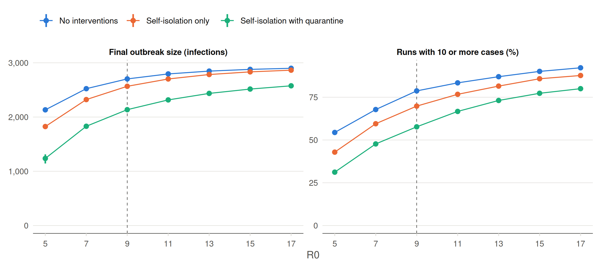

# Main scenarios: R0 from 5 to 17

The three focal scenarios of the main analysis (`make scenarios`) for R0
= 5, 7, …, 17, with the POLYMOD contact matrix, no isolation
willingness, and 90% quarantine willingness:

- No interventions: no rash contact reduction and no contact tracing.
- Self-isolation only: 50% rash contact reduction, no contact tracing.
- Self-isolation with quarantine: 75% rash contact reduction and 25%
  contact-tracing success, with a 21-day quarantine.

As in Figure 4 (R0 = 9), self-isolation with quarantine uses the run
with quarantine and the other two scenarios the run without. Each
scenario has 1,000 runs; runs with fewer than 10 cases are early
extinctions, and the final outbreak sizes are over the remaining
(retained) runs.

Table 1: Runs with 10 or more cases out of 1,000, and final outbreak
size at day 365, median (interquartile range) across those runs.

|  R0 | Scenario                       | Retained runs (%) |          Infections |
|----:|:-------------------------------|------------------:|--------------------:|
|   5 | No interventions               |       544 (54.4%) | 2,133 (2,108-2,163) |
|   5 | Self-isolation only            |       429 (42.9%) | 1,825 (1,788-1,862) |
|   5 | Self-isolation with quarantine |       312 (31.2%) | 1,237 (1,144-1,312) |
|   7 | No interventions               |       678 (67.8%) | 2,523 (2,503-2,542) |
|   7 | Self-isolation only            |       595 (59.5%) | 2,322 (2,298-2,347) |
|   7 | Self-isolation with quarantine |       477 (47.7%) | 1,830 (1,792-1,866) |
|   9 | No interventions               |       787 (78.7%) | 2,703 (2,688-2,716) |
|   9 | Self-isolation only            |       698 (69.8%) | 2,567 (2,550-2,584) |
|   9 | Self-isolation with quarantine |       577 (57.7%) | 2,136 (2,104-2,165) |
|  11 | No interventions               |       834 (83.4%) | 2,795 (2,783-2,807) |
|  11 | Self-isolation only            |       767 (76.7%) | 2,702 (2,688-2,717) |
|  11 | Self-isolation with quarantine |       667 (66.7%) | 2,316 (2,292-2,341) |
|  13 | No interventions               |       870 (87.0%) | 2,847 (2,837-2,857) |
|  13 | Self-isolation only            |       815 (81.5%) | 2,784 (2,772-2,795) |
|  13 | Self-isolation with quarantine |       731 (73.1%) | 2,436 (2,414-2,456) |
|  15 | No interventions               |       901 (90.1%) | 2,879 (2,870-2,888) |
|  15 | Self-isolation only            |       858 (85.8%) | 2,833 (2,822-2,843) |
|  15 | Self-isolation with quarantine |       773 (77.3%) | 2,516 (2,495-2,538) |
|  17 | No interventions               |       922 (92.2%) | 2,899 (2,891-2,908) |
|  17 | Self-isolation only            |       877 (87.7%) | 2,864 (2,855-2,874) |
|  17 | Self-isolation with quarantine |       800 (80.0%) | 2,576 (2,558-2,594) |

Figure 1: Final outbreak size at day 365 (median and interquartile range
across the retained runs) and share of runs with 10 or more cases, by
R0. The dashed line marks R0 = 9, the runs of Figure 4.

