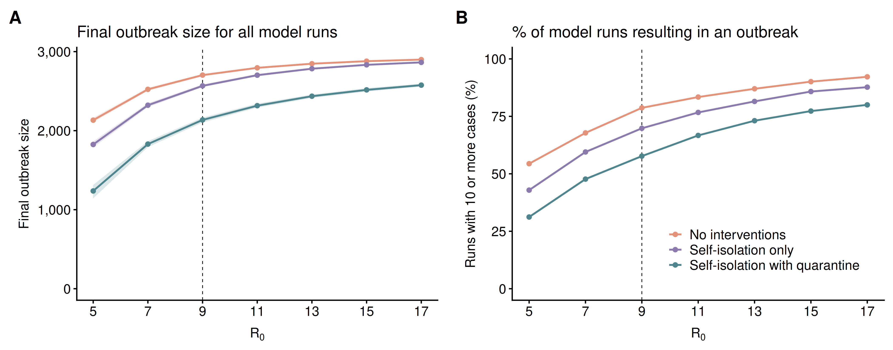

# Main scenarios: R0 from 5 to 17

The three focal scenarios of the main analysis (`make scenarios`) for R0
= 5, 7, …, 17, with the POLYMOD contact matrix, no isolation
willingness, and 90% quarantine willingness:

- No interventions: no rash contact reduction and no contact tracing.
- Self-isolation only: 50% rash contact reduction, no contact tracing.
- Self-isolation with quarantine: 75% rash contact reduction and 25%
  contact-tracing success, with a 21-day quarantine.

As in Figure 4 (R0 = 9), self-isolation with quarantine uses the run
with quarantine and the other two scenarios the run without. Each
scenario has 1,000 runs; runs with fewer than 10 cases are early
extinctions, and the final outbreak sizes are over the remaining
(retained) runs.

Table 1: Table SI 3. Median outbreak size for agent-based-model
simulations that did not go stochastically extinct. Final outbreak size
is measured at day 365; medians and interquartile ranges are across runs
with 10 or more cases.

| R0 | No interventions: Median | No interventions: IQR | Self-isolation only: Median | Self-isolation only: IQR | Self-isolation and quarantine: Median | Self-isolation and quarantine: IQR |
|---:|---:|---:|---:|---:|---:|---:|
| 5 | 2133 | 2,108-2,163 | 1825 | 1,788-1,862 | 1237 | 1,144-1,312 |
| 7 | 2523 | 2,503-2,542 | 2322 | 2,298-2,347 | 1830 | 1,792-1,866 |
| 9 | 2703 | 2,688-2,716 | 2567 | 2,550-2,584 | 2136 | 2,104-2,165 |
| 11 | 2795 | 2,783-2,807 | 2702 | 2,688-2,717 | 2316 | 2,292-2,341 |
| 13 | 2847 | 2,837-2,857 | 2784 | 2,772-2,795 | 2436 | 2,414-2,456 |
| 15 | 2879 | 2,870-2,888 | 2833 | 2,822-2,843 | 2516 | 2,495-2,538 |
| 17 | 2899 | 2,891-2,908 | 2864 | 2,855-2,874 | 2576 | 2,558-2,594 |

Table 2: Table SI 4. Median peak date for agent-based-model simulations
that did not go stochastically extinct. Peak date is the first day of
maximum daily incidence; medians are across runs with 10 or more cases.

|  R0 | No interventions | Self-isolation only | Self-isolation and quarantine |
|----:|-----------------:|--------------------:|------------------------------:|
|   5 |       12-03-2025 |          12-26-2025 |                    01-21-2026 |
|   7 |       11-05-2025 |          11-18-2025 |                    12-07-2025 |
|   9 |       10-21-2025 |          10-29-2025 |                    11-09-2025 |
|  11 |       10-12-2025 |          10-17-2025 |                    10-26-2025 |
|  13 |       10-03-2025 |          10-10-2025 |                    10-19-2025 |
|  15 |       09-29-2025 |          10-04-2025 |                    10-10-2025 |
|  17 |       09-25-2025 |          09-30-2025 |                    10-05-2025 |

Simulations were initialized with a single infectious individual on
August 6, 2025, and 1000 stochastic realizations were performed per
scenario. 213 (21.3%), 302 (30.2%), and 423 (42.3%) resulted in early
extinction (fewer than 10 cases) and were excluded from analysis for no
interventions, self-isolation only, and self-isolation with quarantine,
respectively. Among the remaining simulations, the median outbreak size
was 2,703 infections (IQR: 2,688-2,716) with no interventions, 2,567
infections (IQR: 2,550-2,584) with self-isolation only, and 2,136
infections (IQR: 2,104-2,165) with self-isolation and quarantine (Figure
4). These estimates were 4.6-fold, 4.4-fold, and 3.7-fold higher,
respectively, than the 585 confirmed cases reported in Utah and Arizona
through February 28, 2026. Confirmed cases therefore represented 21.6%,
22.8%, and 27.4% of estimated infections. The probability of a large
outbreak (\>100 cases) was 78.7%, 69.8%, and 57.2% under no
interventions, self-isolation only, and self-isolation with quarantine,
respectively.

The median peak-incidence week began October 20, 2025 and had 498
infections with no interventions, began October 27, 2025 and had 412
infections with self-isolation only, and began November 10, 2025 and had
249 infections with self-isolation and quarantine (Figure 3). Here,
weekly peak incidence is calculated for each retained simulation before
taking the median across simulations. The phylodynamic estimates of
outbreak size were not substantially larger than those from the
agent-based simulations, reflecting concordance between approaches.

Figure 1: Projected outbreak size and probability of sustained
transmission across basic reproduction numbers. Agent-based model
simulations were conducted across values of R0 from 5 to 17 under three
scenarios: no interventions, self-isolation only (50% reduction in
contacts after rash onset), and self-isolation with quarantine (75%
reduction in contacts after rash onset plus contact tracing and
quarantine). (A) Final community outbreak size at day 365: lines show
the median and shaded bands the interquartile range among simulations
with at least 10 cases. (B) Percentage of the 1,000 simulations per
scenario that produced at least 10 cases. The dashed vertical line marks
R0 = 9.

