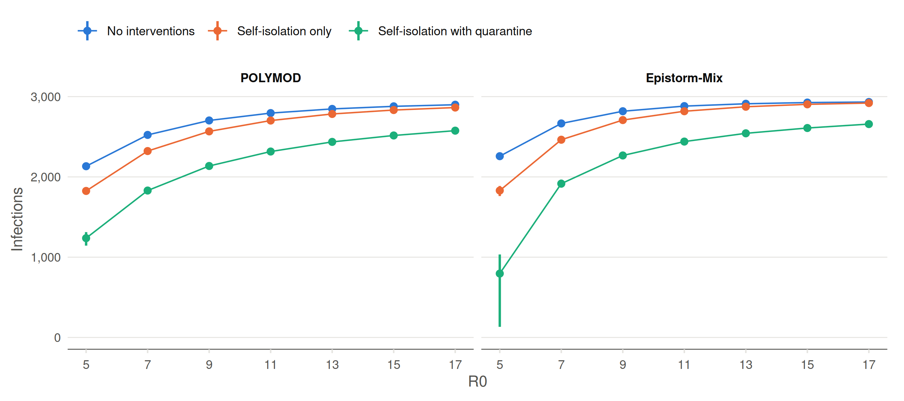

# Sensitivity analysis: contact matrix (Epistorm-Mix)

The three focal scenarios of Figure 4 for R0 = 5, 7, …, 17 with the
Epistorm-Mix contact matrix (`make sensitivity_epistorm`), against the
same scenarios with the POLYMOD matrix of the main analysis
(`make scenarios`, in `scenarios/`). Each scenario has 1,000 runs; runs
with fewer than 10 cases are excluded as early extinctions. As in Figure
4, self-isolation with quarantine uses the run with quarantine and the
other two scenarios the run without.

Table 1: Final outbreak size at day 365, median (interquartile range)
across the retained runs, by contact matrix.

| R0 | Scenario | Retained runs, POLYMOD | Infections, POLYMOD | Retained runs, Epistorm-Mix | Infections, Epistorm-Mix |
|---:|:---|---:|---:|---:|---:|
| 5 | No interventions | 544 | 2,133 (2,108-2,163) | 645 | 2,258 (2,226-2,288) |
| 5 | Self-isolation only | 429 | 1,825 (1,788-1,862) | 503 | 1,830 (1,762-1,887) |
| 5 | Self-isolation with quarantine | 312 | 1,237 (1,144-1,312) | 374 | 796 (132-1,034) |
| 7 | No interventions | 678 | 2,523 (2,503-2,542) | 804 | 2,666 (2,649-2,685) |
| 7 | Self-isolation only | 595 | 2,322 (2,298-2,347) | 691 | 2,463 (2,438-2,487) |
| 7 | Self-isolation with quarantine | 477 | 1,830 (1,792-1,866) | 532 | 1,916 (1,867-1,966) |
| 9 | No interventions | 787 | 2,703 (2,688-2,716) | 881 | 2,818 (2,805-2,828) |
| 9 | Self-isolation only | 698 | 2,567 (2,550-2,584) | 800 | 2,708 (2,691-2,725) |
| 9 | Self-isolation with quarantine | 577 | 2,136 (2,104-2,165) | 668 | 2,267 (2,237-2,297) |
| 11 | No interventions | 834 | 2,795 (2,783-2,807) | 916 | 2,882 (2,872-2,891) |
| 11 | Self-isolation only | 767 | 2,702 (2,688-2,717) | 866 | 2,818 (2,806-2,831) |
| 11 | Self-isolation with quarantine | 667 | 2,316 (2,292-2,341) | 741 | 2,440 (2,416-2,463) |
| 13 | No interventions | 870 | 2,847 (2,837-2,857) | 945 | 2,911 (2,904-2,919) |
| 13 | Self-isolation only | 815 | 2,784 (2,772-2,795) | 904 | 2,874 (2,865-2,884) |
| 13 | Self-isolation with quarantine | 731 | 2,436 (2,414-2,456) | 821 | 2,543 (2,522-2,561) |
| 15 | No interventions | 901 | 2,879 (2,870-2,888) | 956 | 2,926 (2,919-2,934) |
| 15 | Self-isolation only | 858 | 2,833 (2,822-2,843) | 922 | 2,904 (2,895-2,913) |
| 15 | Self-isolation with quarantine | 773 | 2,516 (2,495-2,538) | 865 | 2,609 (2,591-2,628) |
| 17 | No interventions | 922 | 2,899 (2,891-2,908) | 964 | 2,933 (2,926-2,940) |
| 17 | Self-isolation only | 877 | 2,864 (2,855-2,874) | 942 | 2,920 (2,912-2,928) |
| 17 | Self-isolation with quarantine | 800 | 2,576 (2,558-2,594) | 869 | 2,658 (2,643-2,675) |

Figure 1: Final outbreak size at day 365 by R0 and contact matrix:
median and interquartile range across the retained runs.

