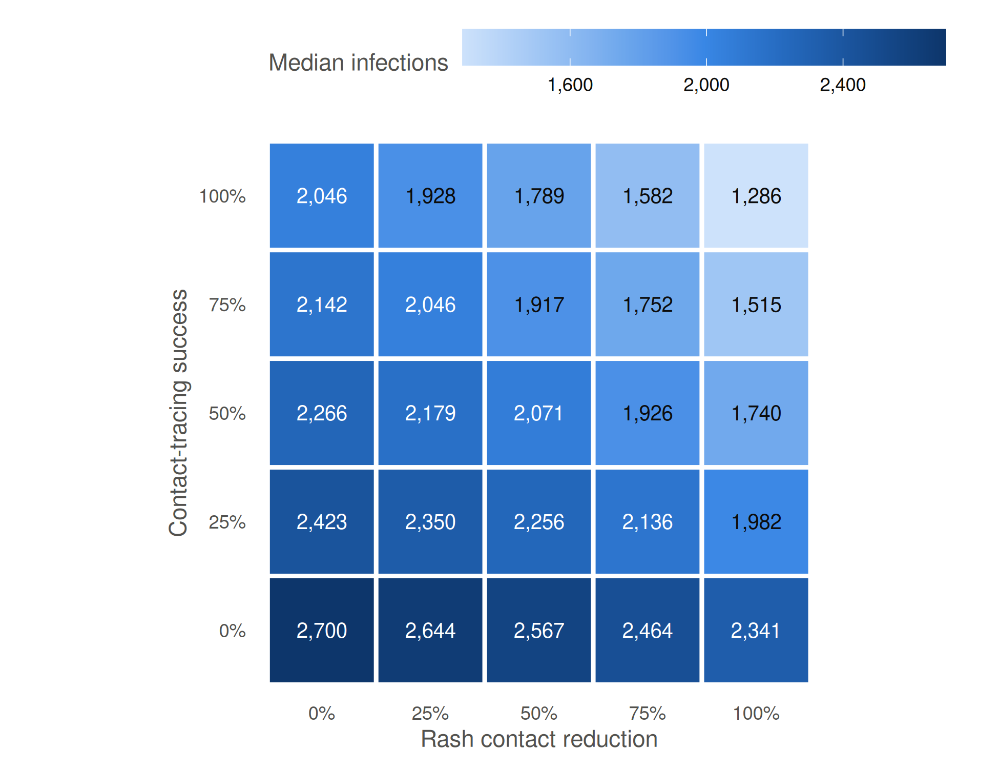

# Sensitivity analysis: rash contact reduction and contact tracing (R0 = 9)

The rash contact reduction (the share of contacts avoided after rash
onset) and the contact-tracing success rate on a grid from 0 to 1 at R0
= 9 (`make sensitivity_rash_redux`), with a 21-day quarantine and 90%
quarantine willingness; the run without quarantine is not used, since
contact tracing only acts through quarantine. Each combination has 1,000
runs; runs with fewer than 10 cases are excluded as early extinctions.
The main analysis uses 0.50 / 0 (self-isolation only) and 0.75 / 0.25
(self-isolation with quarantine). Between 295 and 777 runs are retained
per combination.

Table 1: Final outbreak size at day 365, median (interquartile range)
across the retained runs, by rash contact reduction (rows) and
contact-tracing success (columns).

| Rash contact reduction | Contact tracing 0% | Contact tracing 25% | Contact tracing 50% | Contact tracing 75% | Contact tracing 100% |
|:---|---:|---:|---:|---:|---:|
| 0% | 2,700 (2,686-2,715) | 2,423 (2,402-2,444) | 2,266 (2,240-2,289) | 2,142 (2,114-2,171) | 2,046 (2,012-2,079) |
| 25% | 2,644 (2,628-2,660) | 2,350 (2,328-2,372) | 2,179 (2,149-2,206) | 2,046 (2,009-2,078) | 1,928 (1,888-1,966) |
| 50% | 2,567 (2,549-2,585) | 2,256 (2,230-2,279) | 2,071 (2,042-2,106) | 1,917 (1,880-1,955) | 1,789 (1,737-1,829) |
| 75% | 2,464 (2,442-2,487) | 2,136 (2,104-2,165) | 1,926 (1,888-1,962) | 1,752 (1,711-1,796) | 1,582 (1,522-1,640) |
| 100% | 2,341 (2,314-2,367) | 1,982 (1,944-2,017) | 1,740 (1,684-1,790) | 1,515 (1,437-1,579) | 1,286 (1,036-1,367) |

Figure 1: Median final outbreak size at day 365 across the retained
runs, by rash contact reduction and contact-tracing success.

