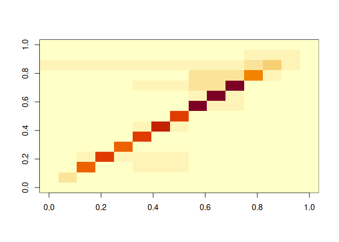
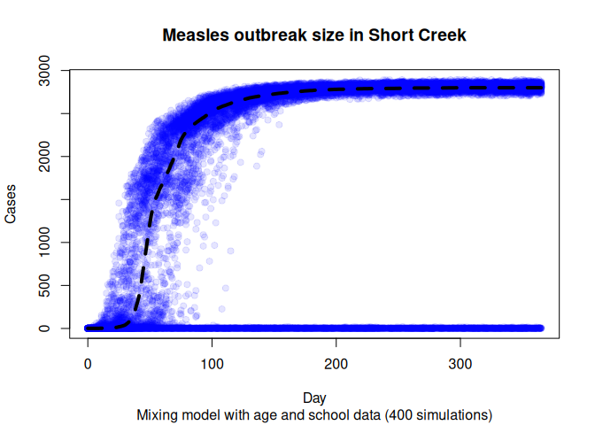
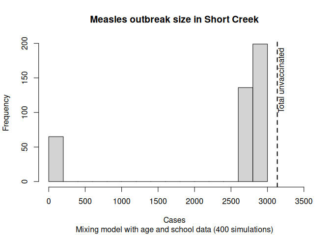
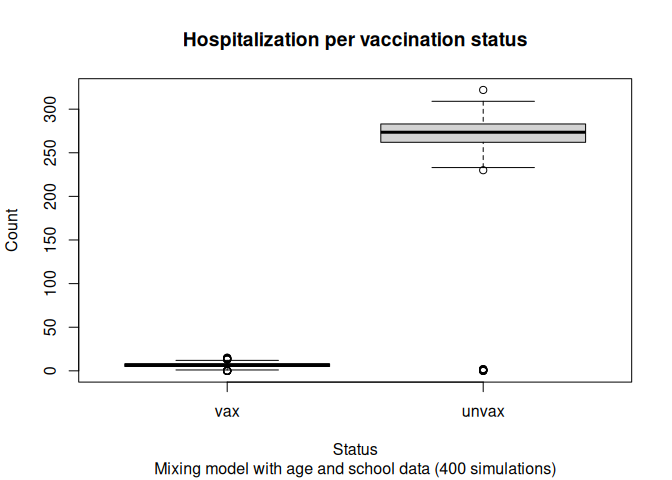
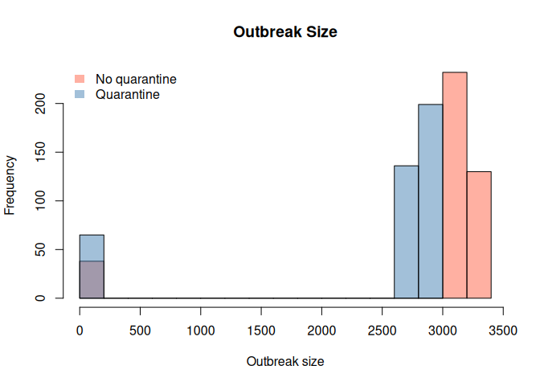
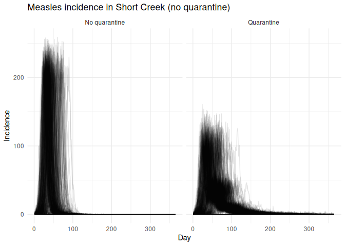

George G. Vega Yon, Ph.D.
2026-04-26

# Scenario of Short Creek Measles Outbreak (R0 = 18)

> [!WARNING]
>
> ### Warning
>
> The data and model used in this vignette are for demonstration
> purposes only and do not reflect real-world conditions accurately. As
> in most agent-based models, the simulations performed here are
> simplified representations of the reality and provide rich information
> for scenario modeling, but not necessarily for forecasting or
> parameter estimation.

During the 2025 US Measles outbreak, the number of cases in the state of
Utah started to climb quickly in the Short Creek region (on the
Utah-Arizona border). This vignette shows how we can use the mixing
model of the `measles` R package to do scenario modeling of the
situation using both age and school data.

## Set up

We start by loading the `measles` R package. Since the package depends
on <a href="https://cran.r-project.org/package=epiworldR"
target="_blank"><code>epiworldR</code></a>, `epiworldR` is loaded
automatically too:

``` r
library(measles)
```

    Loading required package: epiworldR

    Thank you for using epiworldR! Please consider citing it in your work.
    You can find the citation information by running
      citation("epiworldR")

For the data, we need two datasets: information about the population
distribution by age and vaccination status, and the contact matrix. The
`measles` R package comes with a pre-processed dataset that was created
using the [`multigroup.vaccine` R
package](https://github.com/EpiForeSITE/multigroup-vaccine). This data
uses real vaccination rates from publicly available school records, and
population age structure and composition from the latest US census.
Vaccination rates for the non-school-aged population were imputed based
on assumptions and do not reflect the actual vaccination information for
those age groups. We can load the needed data using the `data()`
function:

``` r
data(short_creek, package = "measles")
data(short_creek_matrix, package = "measles")
```

Let’s take a look at the datasets:

``` r
short_creek
```

       age_labels agepops agelims vacc_rate
    1      under1     113       1 0.0000000
    2        1to4     450       4 0.2355556
    3     5to11s1     281      11 0.0569395
    4     5to11s2     393      11 0.3180662
    5     5to11s3     213      11 0.3661972
    6    12to13s4      85      13 0.2235294
    7    12to13s5     149      13 0.3557047
    8    12to13s6      83      13 0.5783133
    9    14to17s7     178      17 0.1460674
    10   14to17s8     169      17 0.2307692
    11   14to17s9     320      17 0.2812500
    12     18to24     892      24 0.2331839
    13     25to44    1279      44 0.5770133
    14     45to69     962      69 0.9209979
    15        70+      63      90 1.0000000

As we can see, the vaccination rates in this area are significantly low.
The vaccination rate needed to avert an outbreak is close to the 0.93
percent of the population. The overall vaccination rate is 44.3161634%,
meaning that 3135 people are unvaccinated. Let’s now look at the first
few entries of the contact matrix

``` r
# Looking at the first 5 columns
short_creek_matrix[, 1:5] |>
  round(2)
```

             under1 1to4 5to11s1 5to11s2 5to11s3
    under1     0.67 1.13    0.32    0.45    0.24
    1to4       0.28 4.71    0.86    1.20    0.65
    5to11s1    0.13 1.37   12.43    2.08    1.13
    5to11s2    0.13 1.37    1.49   13.02    1.13
    5to11s3    0.13 1.37    1.49    2.08   12.07
    12to13s4   0.07 0.51    1.61    2.25    1.22
    12to13s5   0.07 0.51    1.61    2.25    1.22
    12to13s6   0.07 0.51    1.61    2.25    1.22
    14to17s7   0.08 0.38    0.45    0.63    0.34
    14to17s8   0.08 0.38    0.45    0.63    0.34
    14to17s9   0.08 0.38    0.45    0.63    0.34
    18to24     0.07 0.45    0.26    0.37    0.20
    25to44     0.17 1.03    0.66    0.92    0.50
    45to69     0.08 0.50    0.31    0.43    0.23
    70+        0.02 0.22    0.15    0.20    0.11

``` r
# Looking at it as a heatmap
image(short_creek_matrix)
```



One important thing to note is that the data in `short_creek` must
coincide with that in the contact matrix, particularly, there should be
one entry in the `data.frame` for each row/column of the contact matrix.

## Creating the model

The measles models have many parameters. One that is of particular
importance is the hospitalization rate. The hospitalization rate is not
a probability, so, to match a 10% hospitalization probability, we need
to do some calculations. The hospitalization probability is given by the
following formula:

$$P(\text{hospitalization}) = \frac{\text{hospitalization}_\text{rate}}{\text{hospitalization}_\text{rate} + \text{recovery}_\text{rate}}$$

Where the $\text{recovery}_\text{rate}$ is given by the rash period
(1/duration of it, three days in this simulation). Programatically, we
can do the following:

``` r
N <- sum(short_creek$agepops)

# Finding hospitalization rate for
# a 10% hospitalization probability
# P(hosp) = hosp_r / (hosp_r + rec_r)
#   => hosp_r = P(hosp) (hosp_r + rec_r)
#             = P(hosp) * hosp_r + P(hosp) * rec_r
#   => hosp_r = P(hosp) * rec_r / (1 - P(hosp))
h_rate <- 0.1 * (1 / 3) / (1 - 0.1)
```

For calibration, we can make use of the function
`calibrate_mixing_model()`, which will give us the needed scaleing
factor to apply to the transmission probability (or contact matrix) to
get the desired R0. In this case, we will use an R0 of 18, which is
consistent with the literature on measles.

> [!IMPORTANT]
>
> While the decision to calibrate the contact matrix or the transmission
> probability is most likely irrelevant for the effective reproductive
> number, downscaling the contact matrix may result in fewer cases
> quarantined, which will affect the outbreak size.

``` r
r0 <- params$r0
scaling_factor <- calibrate_mixing_model(
  contact_matrix = short_creek_matrix,
  target_rep_number = r0,
  infectious_period_days = 4,
  transmission_prob = 0.2
)
```

``` r
measles_model <- ModelMeaslesMixing(
  n                            = N,
  prevalence                   = 1 / N,
  transmission_rate            = 0.2 * scaling_factor,
  vax_efficacy                 = 0.97,
  contact_matrix               = short_creek_matrix,
  prop_vaccinated              = 0.0, # This is modified later
  # Quarantine and isolation parameters
  days_undetected              = 2,
  quarantine_period            = 21,
  quarantine_willingness       = 0.9,
  isolation_willingness        = 0.9,
  isolation_period             = 4,
  contact_tracing_success_rate = 0.8,
  contact_tracing_days_window  = 4,
  # Disease paramters
  rash_period                  = 3,
  prodromal_period             = 4,
  hospitalization_rate         = h_rate,
  hospitalization_period       = 7
)
```

Now, since this is a mixing model, we are required to specify the
entities. To do so, we can either use the functions `entity()` and
`add_entity()`, or use the wrapper `add_entities_from_dataframe()` as
follows:

``` r
# Adding the entities to the model
add_entities_from_dataframe(
  model = measles_model,
  entities = short_creek,
  col_name = "age_labels",
  col_number = "agepops",
  as_proportion = FALSE
)
```

We can also specify the vaccination rates. There are multiple ways in
which we can do that. The default behavior of the model is, at each run,
randomly sample `prop_vaccinated` percent of the population and assign
the vaccine. Thus, the number of vaccinated individuals will be constant
across simulations. Nonetheless, since the schools and age groups have
different vaccination rates, it is better to use the
`distribute_tool_to_entities()` function. Like the
`add_entities_from_dataframe()` function, the
`distribute_tool_to_entities()` function simplifies the process:

``` r
# Creating the distribution function
dist_fun <- distribute_tool_to_entities(
  prevalence = short_creek$vacc_rate,
  as_proportion = TRUE
)

# Setting the distribution function
measles_model |>
  get_tool(0) |>
  set_distribution_tool(dist_fun)
```

Now, we can specify what to record from the simulation.

``` r
measles_model |>
  run_multiple(
    ndays = 365,
    nsims = 400,
    seed  = 8812,
    saver = make_saver("outbreak_size", "hospitalizations"),
    nthreads = params$threads
  )
```

    Starting multiple runs (400) using 8 thread(s)
    _________________________________________________________________________
    _________________________________________________________________________
    ||||||||||||||||||||||||||||||||||||||||||||||||||||||||||||||||||||||||| done.

After calling the function `run_multiple()`, the C++ function will write
the information to disk. Before we read in the data, we can take a look
at the summary of the model, which will give us an overview of the last
run, including how much time it spend per simulation, and what is the
transsition matrix for the current run.

``` r
summary(measles_model)
```

    ________________________________________________________________________________
    ________________________________________________________________________________
    SIMULATION STUDY

    Name of the model   : Measles with Mixing and Quarantine
    Population size     : 5630
    Agents' data        : (none)
    Number of entities  : 15
    Days (duration)     : 365 (of 365)
    Number of viruses   : 1
    Last run elapsed t  : 0.00s
    Total elapsed t     : 3.00s (400 runs)
    Last run speed      : 35.44 million agents x day / second
    Average run speed   : 256.73 million agents x day / second
    Rewiring            : off
    Last seed used      : 522087843

    Global events:
     - Quarantine process (runs daily)

    Virus(es):
     - Measles

    Tool(s):
     - MMR

    Model parameters:
     - (IGNORED) Vax improved recovery : 0.5000
     - Contact tracing days window     : 4.0000
     - Contact tracing success rate    : 0.8000
     - Days undetected                 : 2.0000
     - Hospitalization period          : 7.0000
     - Hospitalization rate            : 0.0370
     - Incubation period               : 12.0000
     - Isolation period                : 4.0000
     - Isolation willingness           : 0.9000
     - Prodromal period                : 4.0000
     - Quarantine period               : 21.0000
     - Quarantine willingness          : 0.9000
     - Rash period                     : 3.0000
     - Transmission rate               : 0.1659
     - Vaccination rate                : 0.0e+00
     - Vax efficacy                    : 0.9700

    Distribution of the population at time 365:
      - ( 0) Susceptible             : 5629 -> 2778
      - ( 1) Latent                  :    1 -> 0
      - ( 2) Prodromal               :    0 -> 0
      - ( 3) Rash                    :    0 -> 0
      - ( 4) Isolated                :    0 -> 0
      - ( 5) Isolated Recovered      :    0 -> 1
      - ( 6) Quarantined Latent      :    0 -> 0
      - ( 7) Quarantined Susceptible :    0 -> 0
      - ( 8) Quarantined Prodromal   :    0 -> 0
      - ( 9) Quarantined Recovered   :    0 -> 0
      - (10) Hospitalized            :    0 -> 0
      - (11) Recovered               :    0 -> 2851

    Transition Probabilities:
     - Susceptible              0.99  0.00     -     -     -     -  0.00  0.00     -     -     -     -
     - Latent                      -  0.87  0.08     -     -     -  0.05     -  0.01     -     -     -
     - Prodromal                   -     -  0.74  0.25  0.00     -     -     -  0.01     -     -     -
     - Rash                        -     -     -  0.31  0.31  0.17     -     -     -     -  0.03  0.18
     - Isolated                    -     -     -  0.14  0.49  0.27     -     -     -     -  0.03  0.06
     - Isolated Recovered          -     -     -     -     -  0.56     -     -     -     -     -  0.44
     - Quarantined Latent          -  0.02  0.00     -     -     -  0.90     -  0.08     -     -     -
     - Quarantined Susceptible  0.05     -     -     -     -     -     -  0.95     -     -     -     -
     - Quarantined Prodromal       -     -  0.02     -  0.26     -     -     -  0.72     -     -     -
     - Quarantined Recovered       -     -     -     -     -     -     -     -     -     -     -     -
     - Hospitalized                -     -     -     -     -     -     -     -     -     -  0.87  0.13
     - Recovered                   -     -     -     -     -     -     -     -     -     -     -  1.00

To retrieve the results, we use the `run_multiple_get_results()`
function:

``` r
# Extracting the results
ans <- measles_model |>
  run_multiple_get_results(
    freader = data.table::fread
  )
```

The function call will get us the results as a list of data.frames
(data.table objects in this case). We will use the `data.table` package
to manipulate the information.

``` r
# Converting into data.table format for convenience
library(data.table)
outbreak_size <- ans$outbreak_size |> as.data.table()
hospitalizations <- ans$hospitalizations |> as.data.table()
```

## Outbreak size

Finally, since we are only interested about the final outbreak size (in
this case), can will collapse the data to get the total number of cases
at the final simulation day. Subsequently, we can plot the results using
the `hist` function:

``` r
# Aggregating to get the final
set.seed(331)
nsims <- length(unique(outbreak_size$sim_num))

with(
  outbreak_size[sample(1:.N, 20000)],
  {
    plot(
      x = date,
      y = outbreak_size,
      col = adjustcolor("blue", alpha.f = .1),
      pch = 19,
      ylab = "Cases",
      xlab = "Day",
      main = "Measles outbreak size in Short Creek",
      sub = sprintf(
        "Mixing model with age and school data (%i simulations)",
        nsims
      )
    )
})

# Adding a 50th percentile line
fiftieth <- outbreak_size[,
  .(outbreak_size = quantile(outbreak_size, probs = 0.5)),
  by = date]$outbreak_size

lines(
  x = outbreak_size$date |> unique() |> sort(),
  y = fiftieth,
  col = "black",
  lwd = 4,
  lty = "dashed"
)
```



We can also investigate the distribution of the final counts

``` r
# Aggregating to get the final
hist_ans <- with(
  outbreak_size[date == max(date)],
  {
    hist(
      outbreak_size,
      main = "Measles outbreak size in Short Creek",
      sub = sprintf(
        "Mixing model with age and school data (%i simulations)",
        nsims
      ),
      breaks = 20,
      xlab   = "Cases",
      xlim   = c(0, max(outbreak_size, n_unvax) * 1.1)
    )
})

# Adding the maximum number of unvaccinated individuals as
# a vertical line
abline(v = n_unvax, col = "black", lwd = 2, lty = "dashed")
text(
  x = n_unvax,
  y = hist_ans$counts |> max() * 0.5,
  labels = "Total unvaccinated",
  pos = 4,
  srt = 90,
  col = "black"
)
```



The probability of a large outbreak (more than 100 cases) is 83.75%.

## Hospitalizations

In the case of the hospitalizations, we can draw a similar figure. The
hospitalizations data contains the following information:

1.  Cases per virus (just measles in this case).
2.  Cases per tool (or the lack of). Information about “no tool” is
    recorded with a `tool_id == -1`.
3.  The counts (how many records in the data).
4.  Weights.

The weights attribute is to ensure that we take into consideration
counting individuals more than once. For instance, if a model has more
than one tool (not just vaccination), the individual who has two tools
would be included twice in `count`. Thus, if we wanted to count the raw
number of hospitalization cases, we would add across `weight`, but the
`count` variable yields how many individuals were hospitalized under
that combination of tool and virus id.

``` r
hosp_tot <- hospitalizations[, .(total = sum(count)), by = .(sim_num, tool_id)]
hosp_tot[, status := fifelse(tool_id == -1, "Unvax", "Vax")]
hosp_tot[, tool_id := NULL]
```

We can create a couple of boxplot to show how many cases we see per
vaccination status:

``` r
hosp_tot <- merge(
  hosp_tot[status == "Unvax", .(sim_num, unvax = total)],
  hosp_tot[status == "Vax", .(sim_num, vax = total)],
  all = TRUE
)

# Filling zeros
hosp_tot[, unvax := fcoalesce(unvax, 0L)]
hosp_tot[, vax := fcoalesce(vax, 0L)]

hosp_tot[, .(vax, unvax)] |>
  as.matrix() |>
  boxplot(
    ylab = "Count",
    xlab = "Status",
    main = "Hospitalization per vaccination status",
    sub  = sprintf(
      "Mixing model with age and school data (%i simulations)",
      nsims
    )
  )
```



## Scenario without Quarantine

The previous scenario included a quarantine process based on contact
tracing. Using the same model object, we can run a separate scenario
that does not include quarantine. To do so, we simply need to set the
quarantine duration to `-1`, which effectively disables the quarantine
process. We can do this as follows:

``` r
# Setting the new parameter
set_param(measles_model, "Quarantine period", -1)

# We can now re-run the model (we need a new saver)
measles_model |>
  run_multiple(
    ndays = 365,
    nsims = 400,
    seed  = 8812,
    saver = make_saver("outbreak_size", "hospitalizations"),
    nthreads = params$threads
  )
```

    Starting multiple runs (400) using 8 thread(s)
    _________________________________________________________________________
    _________________________________________________________________________
    ||||||||||||||||||||||||||||||||||||||||||||||||||||||||||||||||||||||||| done.

``` r
# Checking no quarantine in scenario summary
summary(measles_model)
```

    ________________________________________________________________________________
    ________________________________________________________________________________
    SIMULATION STUDY

    Name of the model   : Measles with Mixing and Quarantine
    Population size     : 5630
    Agents' data        : (none)
    Number of entities  : 15
    Days (duration)     : 365 (of 365)
    Number of viruses   : 1
    Last run elapsed t  : 0.00s
    Total elapsed t     : 7.00s (800 runs)
    Last run speed      : 27.85 million agents x day / second
    Average run speed   : 217.43 million agents x day / second
    Rewiring            : off
    Last seed used      : 522087843

    Global events:
     - Quarantine process (runs daily)

    Virus(es):
     - Measles

    Tool(s):
     - MMR

    Model parameters:
     - (IGNORED) Vax improved recovery : 0.5000
     - Contact tracing days window     : 4.0000
     - Contact tracing success rate    : 0.8000
     - Days undetected                 : 2.0000
     - Hospitalization period          : 7.0000
     - Hospitalization rate            : 0.0370
     - Incubation period               : 12.0000
     - Isolation period                : 4.0000
     - Isolation willingness           : 0.9000
     - Prodromal period                : 4.0000
     - Quarantine period               : -1.0000
     - Quarantine willingness          : 0.9000
     - Rash period                     : 3.0000
     - Transmission rate               : 0.1659
     - Vaccination rate                : 0.0e+00
     - Vax efficacy                    : 0.9700

    Distribution of the population at time 365:
      - ( 0) Susceptible             : 5629 -> 2416
      - ( 1) Latent                  :    1 -> 0
      - ( 2) Prodromal               :    0 -> 0
      - ( 3) Rash                    :    0 -> 0
      - ( 4) Isolated                :    0 -> 0
      - ( 5) Isolated Recovered      :    0 -> 1
      - ( 6) Quarantined Latent      :    0 -> 0
      - ( 7) Quarantined Susceptible :    0 -> 0
      - ( 8) Quarantined Prodromal   :    0 -> 0
      - ( 9) Quarantined Recovered   :    0 -> 0
      - (10) Hospitalized            :    0 -> 0
      - (11) Recovered               :    0 -> 3213

    Transition Probabilities:
     - Susceptible              1.00  0.00     -     -     -     -     -     -     -     -     -     -
     - Latent                      -  0.92  0.08     -     -     -     -     -     -     -     -     -
     - Prodromal                   -     -  0.75  0.25     -     -     -     -     -     -     -     -
     - Rash                        -     -     -  0.32  0.32  0.17     -     -     -     -  0.04  0.16
     - Isolated                    -     -     -  0.22  0.40  0.23     -     -     -     -  0.04  0.11
     - Isolated Recovered          -     -     -     -     -  0.54     -     -     -     -     -  0.46
     - Quarantined Latent          -     -     -     -     -     -     -     -     -     -     -     -
     - Quarantined Susceptible     -     -     -     -     -     -     -     -     -     -     -     -
     - Quarantined Prodromal       -     -     -     -     -     -     -     -     -     -     -     -
     - Quarantined Recovered       -     -     -     -     -     -     -     -     -     -     -     -
     - Hospitalized                -     -     -     -     -     -     -     -     -     -  0.85  0.15
     - Recovered                   -     -     -     -     -     -     -     -     -     -     -  1.00

Like before, we can extract the results using the
`run_multiple_get_results()` function:

``` r
# Extracting the results
ans_no_quarantine <- measles_model |>
  run_multiple_get_results(
    freader = data.table::fread
  )

outbreak_size_no_quarantine <-
  ans_no_quarantine$outbreak_size |> as.data.table()
hospitalizations_no_quarantine <-
  ans_no_quarantine$hospitalizations |> as.data.table()
```

We can compare both using a simple boxplot:

``` r
os_nq <- outbreak_size_no_quarantine[date == max(date)]$outbreak_size
os_q  <- outbreak_size[date == max(date)]$outbreak_size

bar_cols <- c("tomato", "steelblue") |>
  adjustcolor(alpha.f = 0.5)

hist(
  os_nq, breaks = 20,
  main = "Outbreak Size",
  col = bar_cols[1],
  xlab = "Outbreak size"
)
hist(
  os_q,
  col = bar_cols[2],
  add = TRUE, breaks = 20
)

legend(
  "topleft",
  legend = c("No quarantine", "Quarantine"),
  fill = bar_cols,
  border = NA,
  bty = "n"
)
```



The probability of observing an outbreak of more than 100 cases is
83.75% with quarantine, and 90.50% without quarantine. So, although
mild, the quarantine process seems to have an effect in the outbreak
size, with a higher number of cases observed in the scenario without
quarantine.

## Analyzing the peak time

``` r
peak_no_quarantine <- rbind(
  outbreak_size_no_quarantine[,
    .(
      incidence = diff(outbreak_size),
      date = date[-1],
      type = "No quarantine"
      ), by = sim_num
    ],
  outbreak_size[,
    .(
      incidence = diff(outbreak_size),
      date = date[-1],
      type = "Quarantine"
      ), by = sim_num
    ]
)

library(ggplot2)

peak_no_quarantine |>
  ggplot(aes(
    x = date, y = incidence, group = sim_num
    )) +
    facet_wrap(~ type) +
    geom_line(alpha = 0.1) +
    labs(
      title = "Measles incidence in Short Creek (no quarantine)",
      x = "Day",
      y = "Incidence"
    ) +
    theme_minimal()
```



## Final comments

Ultimately, based on the current results, we would be expecting a large
proportion (close to 85%) of unvaccinated individuals to become
infected, with a small number of vaccinated individuals also getting
infected. Running other scenarios where the quarantine process is not
implemented results in unvaccinated individuals having a higher chance
of becoming infected. This is consistent with the high R0 of measles and
the low vaccination rates in the area. Nonetheless, these results should
be taken with caution, as this simulation is a simplification of reality
that does not consider, for example, individuals’ changing their
behavior as a function of what is observed; it would be natural to
expect some level of precaution, *e.g.*, reducing contact rates, would
be observed in such a situation.
